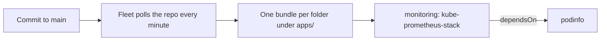

# homelab-gitops

GitOps configuration for my home Kubernetes cluster. Every workload on the
cluster is declared here, and [Fleet](https://fleet.rancher.io/) applies
whatever is on `main`. Changes go in as commits, not `kubectl` commands.

## The cluster

- Three nodes running RKE2 v1.35 on Ubuntu: one control-plane/etcd node and two workers
- Rancher for cluster management, with Fleet for continuous delivery
- MetalLB in L2 mode for `LoadBalancer` services on bare metal
- cert-manager and the RKE2 NGINX ingress controller
- local-path-provisioner for persistent volumes on disks attached to the worker nodes
- Its own network segment behind the home firewall

## How a change gets deployed



Fleet finds each `fleet.yaml` under `apps/`, turns that folder into a bundle,
and installs it as a Helm release. `bootstrap/gitrepo.yaml` is the one
resource applied by hand; it tells Fleet to watch this repo.

## What runs here

| Folder | What it deploys | Notes |
| --- | --- | --- |
| `apps/monitoring` | Prometheus, Grafana, Alertmanager (kube-prometheus-stack 92.7.0) | 10 days of metrics on a 20 GiB volume; Grafana on a MetalLB address |
| `apps/podinfo` | podinfo 6.15.0, a small demo web app | 2 replicas; Prometheus scrapes it through its ServiceMonitor |

## Design choices

- **Pinned chart versions.** Every chart is pinned to an exact version, chosen
  at least two weeks after its release. Upgrades are deliberate commits, not
  surprises.
- **No secrets in Git.** The Grafana admin login is a Kubernetes Secret
  created outside this repo (below). The chart only references it by name.
- **Explicit ordering.** podinfo ships a `ServiceMonitor`, whose CRD comes from
  the monitoring bundle, so the podinfo bundle declares `dependsOn` and waits.
- **No false alarms on RKE2.** RKE2 binds etcd, the scheduler, the controller
  manager and kube-proxy to localhost, so the chart's scrape jobs for them are
  turned off instead of leaving `TargetDown` alerts firing forever.
- **Cluster-wide service discovery.** Prometheus picks up ServiceMonitors from
  every namespace, so a new app only needs its own monitor to be scraped.

## Bootstrapping a cluster from this repo

```sh
# 1. Grafana's admin login, kept out of Git
kubectl create namespace monitoring
kubectl -n monitoring create secret generic grafana-admin \
  --from-literal=admin-user=admin \
  --from-literal=admin-password="$(openssl rand -base64 24)"

# 2. Point Fleet at this repo
kubectl apply -f bootstrap/gitrepo.yaml

# 3. Watch it deploy
kubectl -n fleet-local get gitrepos,bundles
```
